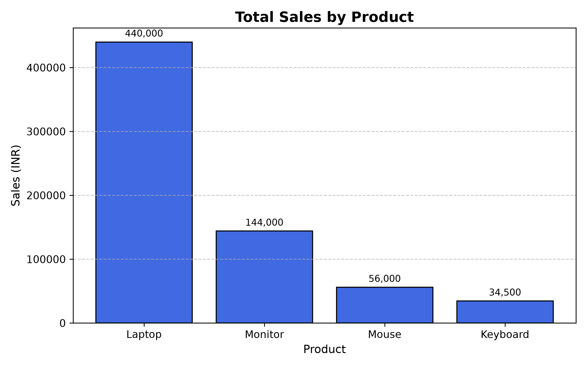
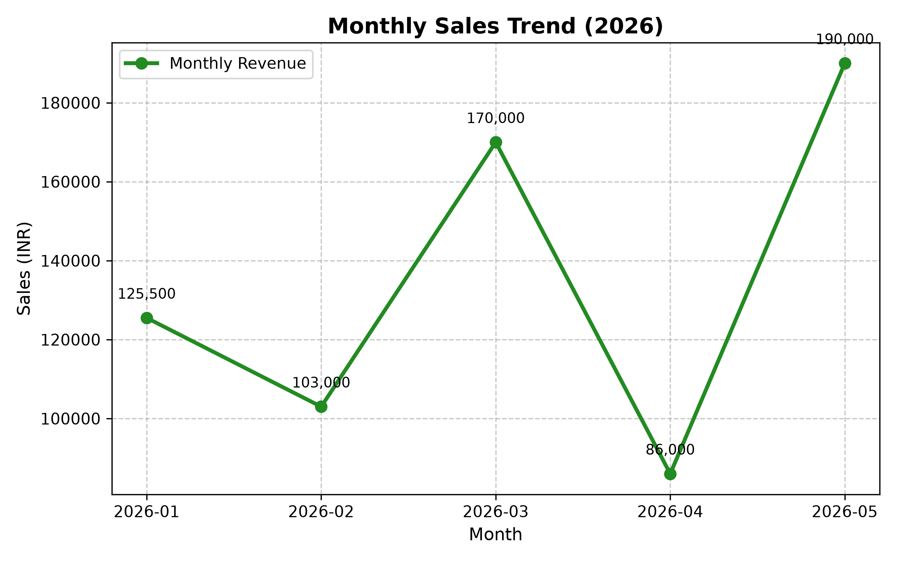
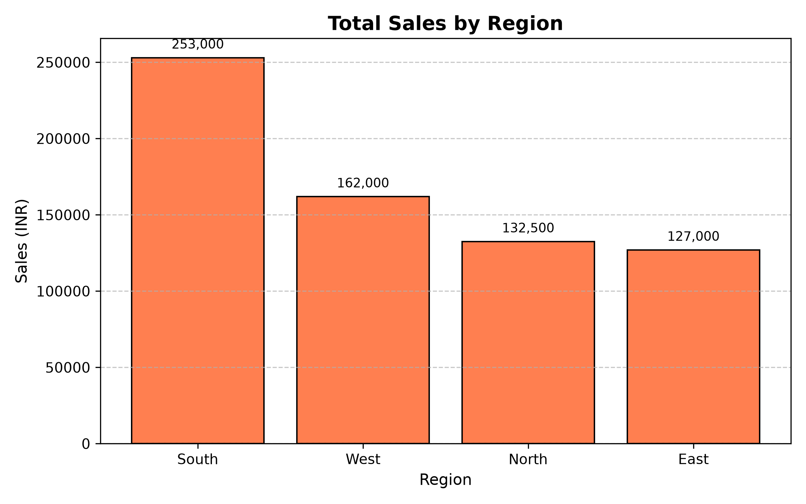

# Sales Data Analysis & Visualization

An end-to-end Python data analysis project built with **Pandas**, **NumPy**, and **Matplotlib** to analyze retail transaction records, calculate key business performance metrics, and generate visual reports.

---

## 1. Project Overview

This project provides a clean, modular, and beginner-friendly workflow for analyzing retail sales data. It ingests transactional records from a CSV file, performs data validation and type conversion, engineers new financial metrics, aggregates performance across products, regions, and months, and exports publication-ready charts.

---

## 2. Problem Statement

Retail businesses frequently collect transaction data but struggle to quickly extract actionable insights regarding revenue concentration, regional demand, and purchasing patterns. Without automated analysis and visualization scripts, business stakeholders must manually compute metrics and chart performance, increasing the risk of calculation errors and delaying decision-making.

---

## 3. Objectives

- **Automate Ingestion & Cleaning**: Load tabular sales data, validate against missing values, and convert date strings into true datetime objects.
- **Compute Core Metrics**: Calculate total revenue, total units sold, transaction count, and Average Order Value (AOV).
- **Segment Performance**: Group and evaluate sales performance by product line, geographical region, and monthly timelines.
- **Generate Visualizations**: Automatically produce and save clear, labeled charts for presentation and reporting.
- **Derive Data-Backed Insights**: Provide factual conclusions directly supported by transaction evidence.

---

## 4. Technologies Used

- **Python 3.10+**: Core programming language.
- **Pandas**: Data ingestion (`read_csv`), data manipulation, datetime conversion, and grouping operations (`groupby`).
- **NumPy**: Numerical operations and statistical averaging (`mean`).
- **Matplotlib**: Figure generation, bar charts, line plots, custom labeling, and high-resolution image export (`savefig`).

---

## 5. Features

- **Automated Data Validation**: Scans all columns for null/missing values and reports data health.
- **Feature Engineering**: Calculates transaction revenue on the fly (`Quantity * Price`).
- **Dynamic Date Handling**: Extracts calendar periods (`YYYY-MM`) for chronological trend analysis.
- **Terminal Business Summary**: Prints an organized, easy-to-read financial summary directly to the console.
- **Automated Chart Export**: Creates and saves high-resolution (300 DPI) chart images to the `output/` directory with explicit value labels.

---

## 6. Project Structure

```text
sales-data-analysis/
├── data/
│   └── sales_data.csv            # Raw sales transaction dataset
├── output/
│   ├── monthly_sales_trend.png   # Line chart of monthly revenue
│   ├── sales_by_product.png      # Bar chart of sales by product
│   └── sales_by_region.png       # Bar chart of sales by region
├── screenshots/
│   ├── monthly_sales_trend.png   # Exported chart for GitHub README preview
│   ├── sales_by_product.png      # Exported chart for GitHub README preview
│   └── sales_by_region.png       # Exported chart for GitHub README preview
├── src/
│   └── analysis.py               # Main Python analysis script
├── .gitignore                    # Excludes venv, cache, and OS files
├── requirements.txt              # Project dependencies
└── README.md                     # Project documentation
```

---

## 7. How to Install Dependencies

### Prerequisites
Make sure Python (version 3.10 or higher) is installed on your computer.

### Step 1: Clone or Open the Project
Open your terminal and navigate to the project directory:
```bash
cd sales-data-analysis
```

### Step 2: Set Up a Virtual Environment

**Windows (PowerShell):**
```powershell
python -m venv venv
.\venv\Scripts\Activate.ps1
```

**macOS / Linux:**
```bash
python3 -m venv venv
source venv/bin/activate
```

### Step 3: Install Required Packages
```bash
pip install -r requirements.txt
```

---

## 8. How to Run the Project

Run the analysis script from the root `sales-data-analysis` directory:

```bash
python src/analysis.py
```

Upon execution, the terminal will display the full metrics report, and all charts will be generated inside the `output/` folder.

---

## 9. Analysis Performed

1. **Missing Value Inspection**: Verified dataset integrity using `.isnull().sum()` (0 missing values detected).
2. **Datetime Conversion**: Converted string dates to `datetime64` for date extraction.
3. **Transaction Value Calculation**: Created a `Sales` column via `Quantity * Price`.
4. **Overall Metric Aggregations**:
   - Total Sales Revenue: `INR 674,500.00`
   - Total Quantity Sold: `113 units`
   - Orders Analyzed: `15 transactions`
   - Average Order Value (AOV): `INR 44,966.67`
5. **Categorical & Temporal Groupings**:
   - **Product Breakdown**: Ranked products by total sales.
   - **Regional Breakdown**: Evaluated geographical contribution.
   - **Monthly Trends**: Tracked revenue progression from January to May 2026.

---

## 10. Charts Generated

All charts are saved automatically to the `output/` folder and mirrored in `screenshots/` for GitHub display:

| Chart | Filename | Description |
| :--- | :--- | :--- |
| **Sales by Product** | `sales_by_product.png` | Bar chart displaying total revenue generated per product line. |
| **Monthly Sales Trend** | `monthly_sales_trend.png` | Line plot tracking chronological revenue movement across months. |
| **Sales by Region** | `sales_by_region.png` | Bar chart comparing sales volume and revenue across territories. |

### Visual Previews

#### 1. Sales by Product


#### 2. Monthly Sales Trend


#### 3. Sales by Region


---

## 11. Key Insights

1. **Heavy Revenue Concentration in Laptops**: Laptops generated **INR 440,000.00** (**65.23%** of total revenue) from only **8 units sold** (7.08% of total unit volume).
2. **High-Volume, Low-Ticket Accessories**: Mouses accounted for **61.95%** of all units sold (70 units), yet contributed only **8.30%** of total revenue. Combined, accessories (Mouse + Keyboard) represent **82.30%** of physical units moved.
3. **South Region Outperformed All Territories**: The South region generated **INR 253,000.00** (**37.51%** of total sales) and accounted for **57 units** (50.44% of total volume) across 6 out of 15 orders.
4. **Revenue is Driven by Laptop Sales, Not Unit Volume**: April had high unit volume (31 units) but lowest revenue (INR 86,000.00) because only 1 laptop was sold, whereas March had low unit volume (14 units) but high revenue (INR 170,000.00) due to 2 laptop purchases.
5. **Steady Growth in Accessory Order Sizes**: Order quantity for Mouses grew consistently with every subsequent order recorded (10 → 15 → 20 → 25 units).

---

## 12. Future Improvements

- [ ] Add profit margin analysis once cost-of-goods-sold (COGS) data is available.
- [ ] Implement an interactive dashboard using **Streamlit** or **Dash**.
- [ ] Add unit testing using `pytest` to validate data pipeline calculations automatically.
- [ ] Expand the script to support command-line arguments (CLI) for analyzing custom CSV files.
- [ ] Export summary statistics directly to an Excel or PDF report.
